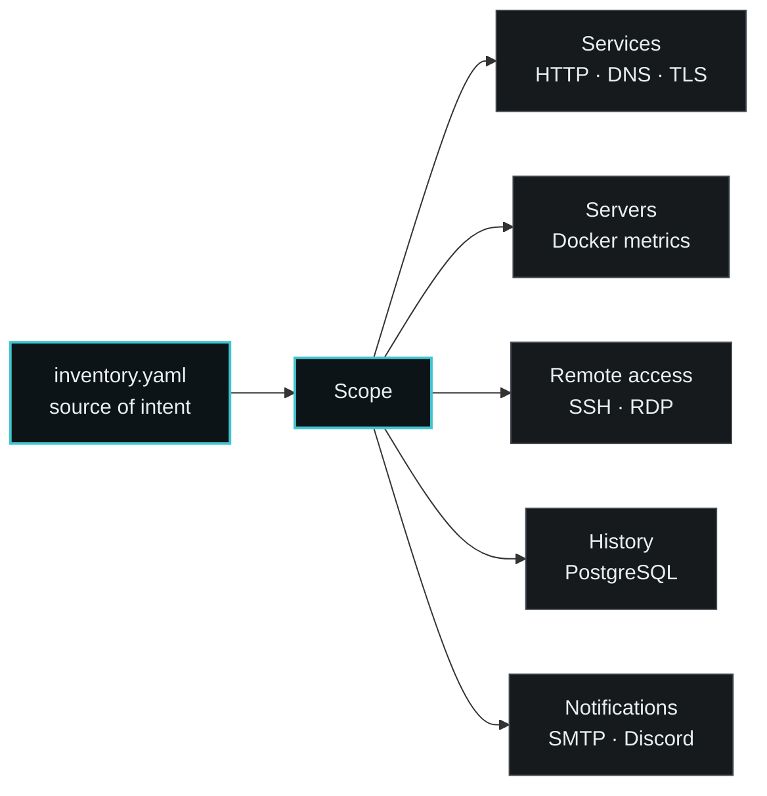
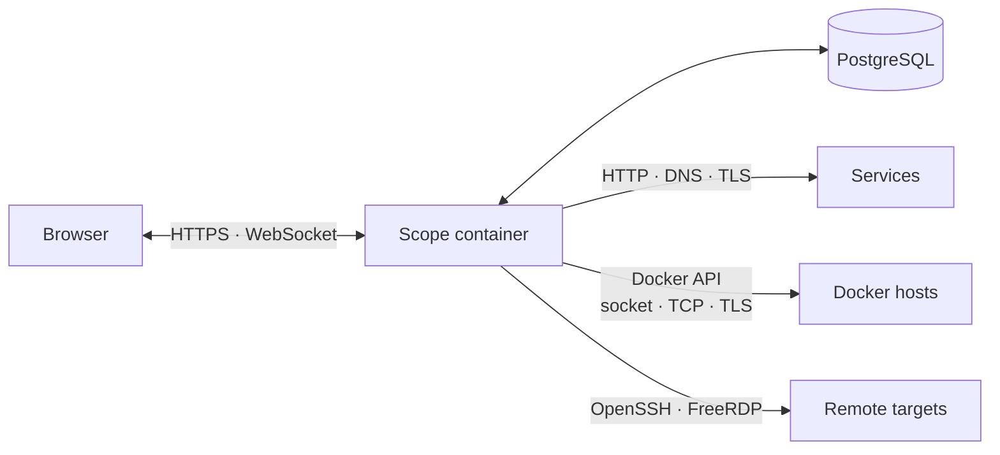
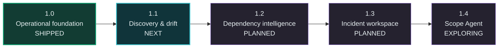

<p align="center">
  
</p>

<h1 align="center">Scope</h1>

<p align="center">
  <strong>Your infrastructure, in context.</strong><br>
  A configuration-driven operations view for services, servers and remote access.
</p>

<p align="center">
  
  
  
  
  <a href="https://github.com/vt-global-de/scope/actions/workflows/ci.yml"></a>
</p>

<p align="center">
  <a href="https://scope.vt-global.de">Website</a> ·
  <a href="https://docs-scope.vt-global.de">Documentation</a> ·
  <a href="ROADMAP.md">Roadmap</a> ·
  <a href="CONTRIBUTING.md">Contributing</a>
</p>

---

Scope brings service availability, Docker host metrics, SSH/RDP sessions, DNS and certificate checks, notifications and status history into one self-hosted interface. A single reviewable YAML inventory describes what exists; Scope turns it into a responsive operational view without hiding infrastructure intent in a database.

It is designed to connect context rather than replace specialist tools: see what is affected, understand its dependencies and jump directly to the system that needs attention.

## One inventory, one operational view



## What ships with Scope 1.0

| | Capability | What it provides |
| --- | --- | --- |
| ◉ | **Scope board** | A focused health summary across configured services and servers. |
| ↗ | **Services** | Dynamic links, groups, tags, favorites, dependencies, DNS and TLS status. |
| ◫ | **Server operations** | Docker CPU, memory, storage, container, volume, network and image metrics. |
| `>_` | **Remote sessions** | Browser-based SSH and RDP with roles, diagnostics and audit events. |
| ◷ | **Status history** | PostgreSQL-backed transitions, availability and recent outages. |
| ◌ | **Notifications** | Durable SMTP and Discord delivery, maintenance windows and suppression. |
| ⠿ | **Personal layouts** | Responsive panels and cards, density, favorites, theme and language per user. |
| ◎ | **Operations API** | Readiness, liveness and optional Prometheus metrics. |

Scope is self-hosted and read-first. It does not use an external remote gateway, and remote credentials are never persisted in PostgreSQL.

## Quick start

Requirements: Docker Engine with Compose and a local checkout of this repository.

```sh
export SCOPE_DB_PASSWORD='replace-with-a-long-random-secret'
docker compose up -d
```

Open [http://localhost:3000](http://localhost:3000). The included example inventory starts without authentication and monitors the local Docker socket. Enable `authenticate: true` before exposing Scope beyond a trusted local environment; the first administrator is then created in the WebUI.

```sh
docker compose ps
docker compose logs -f scope
```

The example stack uses the immutable `ghcr.io/vt-global-de/scope:1.0.0` image. Build the image locally only when developing Scope itself:

```sh
docker build -t scope:local .
SCOPE_IMAGE=scope:local docker compose up -d
```

> [!IMPORTANT]
> Scope can access the Docker socket and open remote sessions. Use TLS, enable authentication and follow least-privilege network design for production deployments.

## Configuration as code

`config/inventory.yaml` is the only functional configuration source. Stable IDs connect targets to dependencies, history and personal layouts; defaults keep larger inventories concise.

```yaml
version: 1
title: Scope
subtitle: Infrastructure Control Plane
authenticate: true

menu:
  services:
    navigation-label: Areas
    groups:
      - id: production
        name: Production
        categories:
          - id: core-services
            name: Core services
            services:
              - id: gitlab
                name: GitLab
                url: https://gitlab.example.com
                icon: gitlab
                certificates: true
                dns: true
                depends-on: [docker-01]

  server:
    navigation-label: Device groups
    groups:
      - id: production
        name: Production
        categories:
          - id: docker-hosts
            name: Docker hosts
            servers:
              - id: docker-01
                name: Docker 01
                monitoring:
                  connection:
                    type: socket
                remote:
                  protocol: ssh
                  parameters:
                    hostname: docker-01.example.internal
                    username: ${REMOTE_SSH_USERNAME}
                    password: ${REMOTE_SSH_PASSWORD}
```

Validate an inventory before deployment:

```sh
npm run config:check -- /path/to/inventory.yaml
```

See the [canonical example](config/inventory.yaml), [configuration reference](docs/CONFIGURATION.md) and JSON schema at [`config/inventory.schema.json`](config/inventory.schema.json).

## Architecture



The application container owns the WebUI, API, checks and remote-session lifecycle. PostgreSQL stores accounts, preferences, status history, audit events and the notification outbox. OpenSSH, FreeRDP, xterm.js and noVNC are protocol and rendering components—not separate management products.

## Roadmap

Scope 1.0 is the operational foundation. The next releases evolve it from a configured overview into a live infrastructure context and incident workspace while keeping YAML authoritative.



| Release | Direction | Selected outcomes |
| --- | --- | --- |
| **1.0 · Shipped** | Operational foundation | Inventory v1, monitoring, remote sessions, history, notifications and metrics. |
| **1.1 · Next** | Discovery and drift | Docker/Traefik discovery, drift reports and reviewable inventory suggestions. |
| **1.2 · Planned** | Dependency intelligence | Dependency graph, root-cause grouping and blast-radius views. |
| **1.3 · Planned** | Incident workspace | Unified timelines, runbooks, diagnostics and contextual tool links. |
| **1.4 · Exploring** | Scope Agent | Outbound-only collection across network zones with least-privilege enrollment. |

The roadmap communicates direction, not release dates. Read the [full roadmap and product guardrails](ROADMAP.md).

## Documentation

- [Configuration](docs/CONFIGURATION.md) — inventory contract and validation
- [Upgrade, backup and recovery](docs/UPGRADE.md) — migrations and rollback procedure
- [Security policy](SECURITY.md) — supported versions and private reporting
- [Contributing](CONTRIBUTING.md) — development and contribution workflow
- [Changelog](CHANGELOG.md) — released capabilities and changes

For development:

```sh
npm ci
npm run config:check
npm test
npm run test:e2e
npm start
```

## License

Scope is licensed under the [GNU Affero General Public License v3.0 or later](LICENSE). Private and commercial use is permitted under its terms; modified versions offered over a network must make their corresponding source available as required by the license.
